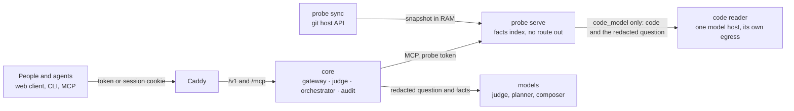

# Mercury

Mercury answers the questions people who don't read code ask about a software project: what is
done, what is tested, what is blocked and on what, how healthy the project is, what changed, and any
other question about the project that isn't off limits, such as how long a change might take: an
estimate, never a promise. It answers from **facts** that a **probe** next to the repository
produces, through a **gateway** that checks every question, every tool call, every fact and every
sentence of the answer with a judge model, and writes every step into a tamper-evident audit.
**No answer can carry code.** Code reaches a model only when a project turns on the code reader, and
then only the one model its configuration names: your own, or, in the `demo` preset alone, an
outside model with zero retention, for a repository made for demos.

```text
$ mercury ask --project delta "show me the export code"
project    delta (as asked)
check      asks_for_code block (rule)
refused    asks_for_code · $0.0000 · judge: rules
Refused: Mercury doesn't show source code, file names or paths.
Ask what is done, tested or blocked in Invoicing, Export or Auth instead.

$ mercury ask --project delta "what is blocked?"
class      blocked (p 1.00)
plan       blocked()
result 1   blocked: 2 items, access code
judged     2 sentences, 0 stripped, 0 held for sign-off
done       0.0 s · $0.0000 · judge: rules · composer: template · audit 87
A work item in Export is blocked, waiting on something not recorded. A work item in Auth is
blocked, without tests, waiting on something not recorded.
```

(Shortened. That is the stack below with no model key at all: the rules judge every step and a template
writes, and with no judge to clear them the repository's titles are withheld, so each item reads "a
work item in <module>". With a key, a judge model and a composer take over, and the timeline says so.)

## How it works



- **People talk to the core, the core talks to probes, probes talk to the repository.** Nobody else
  talks to anybody.
- A probe's `sync` half fetches pull requests, issues, CI runs and releases through the git host's
  API, and a snapshot of the default branch into memory only. Its `serve` half indexes them and
  answers a fixed set of MCP tools with typed facts: statuses, numbers, dates, module names and
  short checked titles. It has no route out and no credentials, and its reply types have no field a
  file path or a line of code could go into. In the `code_model` mode `serve` can also hand the code
  (what `exclude` leaves, under a size cap) and the redacted question to a **code reader**: a
  container of its own whose only way out is an allowlist of one model host. What comes back is at
  most 12 short findings, each through the same text checks as a title and a check that it repeats
  none of the code; the rest are dropped and counted.
- The core decides who may ask what, checks the question, picks the tools from a fixed table
  (a model only fills validated arguments), checks the probe's facts, lets a model write the answer
  from those facts and findings alone, an estimate always worded as one, and checks every sentence
  again before anyone sees it. A judge that fails hands its stage to stricter rules, never to a
  pass. Some answers wait for a person to approve them.

More in [docs/overview.md](docs/overview.md), [docs/security.md](docs/security.md) and the contract
for probes, [docs/probe-spec.md](docs/probe-spec.md).

## Quickstart

On one machine, with the bundled fixture repository: a synthetic invoicing project called `delta`
with its pull requests, issues and CI runs. You need:

- Docker with Compose 2.24 or later;
- [`just`](https://github.com/casey/just);
- Node.js 22 with pnpm through corepack (`corepack enable`);
- bash (Git Bash on Windows);
- to build the CLI from source, Rust through [`rustup`](https://rustup.rs): the toolchain is pinned
  in `rust-toolchain.toml`, and `rustup` installs it on first use.

No model key is needed to start: without one, the rules judge every stage and a template writes the
answer, and the timeline says so.

```bash
git clone https://github.com/CShark-Hub/Los-Angeles-Shippers.git && cd Los-Angeles-Shippers
just compose-up                       # builds the images and the web client, starts them on http://localhost:8080
cd deploy/compose && alias mctl='docker compose -f docker-compose.yml -f docker-compose.fixture.yml -f docker-compose.local.yml exec core mercury-core admin'
mctl user add --email you@example.com --name "You" --role pm && mctl user grant --email you@example.com --projects delta
mctl token create --email you@example.com --label laptop      # prints the token once
```

Open <http://localhost:8080>, paste the token, pick Delta and ask *what is blocked?*.
While it runs the page names the stage the gateway is at; then it shows the answer and the facts it
rests on, with one row per stage of the gateway's checks under *How Mercury checked this*. Or ask
from a terminal with the CLI: take a release's archive for Linux, macOS or Windows (below), or build
it from source. From the repository root (`cd ../..` out of `deploy/compose`), `cargo install --path
crates/mercury-cli` puts `mercury` on your `PATH`; `cargo run -p mercury-cli --` runs it without
installing it. Then sign in with the token and ask:

```bash
mercury login --url http://localhost:8080      # reads the token from standard input
mercury ask --project delta "what is blocked?"
mercury ask --project delta "show me the export code"   # refused: asks_for_code, with what you can ask instead
```

An AI agent asks the same way, over MCP with the person's token, through the same checks; for
Claude Code:

```bash
claude mcp add --transport http mercury http://127.0.0.1:8080/mcp --header "Authorization: Bearer mcy_…"
```

For the models, put an [OpenRouter](https://openrouter.ai) key with a credit limit into
`deploy/compose/secrets/openrouter_api_key` and restart the core, which reads its key files only
when it starts. From `deploy/compose`, with the files the `mctl` alias names:

```bash
docker compose -f docker-compose.yml -f docker-compose.fixture.yml -f docker-compose.local.yml restart core
```

`just compose-down` stops the stack. Your own repositories, users and a server with TLS:
[docs/deploy.md](docs/deploy.md).

### From a release

Each version tag publishes what the quickstart builds, so a server needs no build:

- **The images** on the GitHub Container Registry, for linux/amd64 and linux/arm64:
  `ghcr.io/cshark-hub/mercury-core`, `mercury-probe` and `mercury-web`, tagged with the version
  (`0.1.0` for `v0.1.0`). In `deploy/compose/.env`, `MERCURY_REGISTRY=ghcr.io/cshark-hub` and
  `MERCURY_VERSION=<version>`, then `docker compose pull && docker compose up -d`.
- **The CLI** on the release's page: `mercury-<version>-<target>.tar.gz` for Linux (x86_64,
  aarch64) and macOS (Apple silicon `aarch64-apple-darwin`, Intel `x86_64-apple-darwin`), a `.zip`
  for Windows, each with its `.sha256`. Check it, unpack it and put `mercury` on your `PATH`:
  ```bash
  sha256sum -c mercury-<version>-x86_64-unknown-linux-gnu.tar.gz.sha256   # shasum -a 256 -c on macOS
  tar -xzf mercury-<version>-x86_64-unknown-linux-gnu.tar.gz mercury
  ```
- **The probe conformance runner** for Linux, `mercury-probe-conformance-<version>-<target>.tar.gz`,
  for anyone writing a probe of their own ([docs/probe-spec.md](docs/probe-spec.md)).

The release notes are the version's section of [CHANGELOG.md](CHANGELOG.md).

## Presets

The configuration is plain files the core reads at start, checked by
`mercury-core admin config check`. Three starting points come with it, in `config-examples/presets/`:

| Preset | Models | What leaves your network | Code, when a project uses the code reader |
|---|---|---|---|
| `demo` | a judge and chat models on OpenRouter, zero-retention routing | the redacted question, facts with their titles, redacted titles and labels for the judge | one outside model, zero retention, for a repository made for demos |
| `private` | the same models | the redacted question and facts without titles: statuses, numbers, dates, module names | your own model server only |
| `strict` | every role on a model server of your own (any OpenAI-compatible chat API) | nothing | your own model server only |

No type a probe answers with can hold code, file paths, diffs, commit messages, tokens or keys, so
no answer and no fact carries them, in any preset. The code reader is off until a project is given
the `code_model` mode; only then does code leave the probe, and only to the reader's one model.
Details in [config-examples/presets/README.md](config-examples/presets/README.md).

## Clients

- **The web client** (`apps/web`): a single-page app served by Caddy from the same origin as the
  API. A token is exchanged once for a session cookie the page can't read; nothing sensitive is kept
  in the browser. Ask: under each answer a project manager sees one row per stage with its verdict
  and lowest probability, a tech lead or an admin the gateway's full trail; approvers release or
  reject held answers; an admin reads and exports the audit.
- **The CLI** (`mercury`): `ask` with the same timeline on standard error, `--json` for scripts and
  agents, `approvals`, and `audit` for an admin; exit codes say how a question ended.
- **AI agents** (Claude Code): MCP at `/mcp` with the person's token, through the same checks and
  audit; [docs/deploy.md](docs/deploy.md#ai-agents-over-mcp) shows the setup.
- **The API**: `/v1/*`, described by `/v1/openapi.json`.

## Repository

| Path | What it is |
|---|---|
| `crates/mercury-schema` | every type that crosses a boundary, and the OpenAPI document |
| `crates/mercury-judge` | the judge: a client for the judge model, a chat-model fallback, the rules |
| `crates/mercury-core` | the gateway, the orchestrator, the audit and the `admin` commands |
| `crates/mercury-probe` | the probe: `sync`, `serve`, `reader` (the code reader) and `dev` on a local repository |
| `crates/mercury-cli` | the `mercury` command |
| `apps/web` | the web client |
| `deploy/` | the images, the Compose files, the Caddyfile and the egress proxy |
| `config-examples/` | the configuration and its presets |
| `tests/` | the fixture repository, the runs on Compose, the labelled questions and the attacks |

Contributing: [CONTRIBUTING.md](CONTRIBUTING.md) · security: [SECURITY.md](SECURITY.md) ·
conduct: [CODE_OF_CONDUCT.md](CODE_OF_CONDUCT.md).

## Licence

Mercury is licensed under the [Apache License, Version 2.0](LICENSE).

Copyright (c) 2026 CSHARK Commit Hackathon Contributors

The team, Los Angeles Shippers:

- Mateusz Chmielewski
- Jacek Kaczmarek
- Peter Mate
- Piotr Poświatowski
