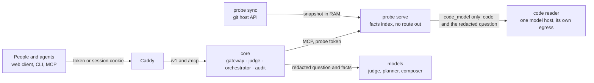

# Mercury

Mercury answers the questions people who don't read code ask about a software project: what is
done, what is tested, what is blocked and on what, how healthy the project is, what changed, and any
other question about the project that isn't off limits, such as how long a change might take: an
estimate, never a promise. It answers from **facts** that a **probe** next to the repository
produces, through a **gateway** that checks every question, every tool call, every fact and every
sentence of the answer with a judge model, and writes every step into a tamper-evident audit.
**No answer can carry code.** Code reaches a model only when a project turns on the code reader, and
then only the one model its configuration names: your own, or, in the `demo` preset alone, an
outside model with zero retention, for a repository made for demos.

```text
$ mercury ask --project delta "show me the export code"
project    delta (as asked)
check      asks_for_code block (rule)
refused    asks_for_code · $0.0000 · judge: rules
Refused: Mercury doesn't show source code, file names or paths.
Ask what is done, tested or blocked in Invoicing, Export or Auth instead.

$ mercury ask --project delta "what is blocked?"
class      blocked (p 1.00)
plan       blocked()
result 1   blocked: 2 items, access code
judged     2 sentences, 0 stripped, 0 held for sign-off
done       0.0 s · $0.0000 · judge: rules · composer: template · audit 87
A work item in Export is blocked, waiting on something not recorded. A work item in Auth is
blocked, without tests, waiting on something not recorded.
```

(Shortened. That is the stack below with no model key at all: the rules judge every step and a template
writes, and with no judge to clear them the repository's titles are withheld, so each item reads "a
work item in <module>". With a key, a judge model and a composer take over, and the timeline says so.)

## How it works



- **People talk to the core, the core talks to probes, probes talk to the repository.** Nobody else
  talks to anybody.
- A probe's `sync` half fetches pull requests, issues, CI runs and releases through the git host's
  API, and a snapshot of the default branch into memory only. Its `serve` half indexes them and
  answers a fixed set of MCP tools with typed facts: statuses, numbers, dates, module names and
  short checked titles. It has no route out and no credentials, and its reply types have no field a
  file path or a line of code could go into. In the `code_model` mode `serve` can also hand the code
  (what `exclude` leaves, under a size cap) and the redacted question to a **code reader**: a
  container of its own whose only way out is an allowlist of one model host. What comes back is at
  most 12 short findings, each through the same text checks as a title and a check that it repeats
  none of the code; the rest are dropped and counted.
- The core decides who may ask what, checks the question, picks the tools from a fixed table
  (a model only fills validated arguments), checks the probe's facts, lets a model write the answer
  from those facts and findings alone, an estimate always worded as one, and checks every sentence
  again before anyone sees it. A judge that fails hands its stage to stricter rules, never to a
  pass. Some answers wait for a person to approve them.

More in [docs/overview.md](docs/overview.md), [docs/security.md](docs/security.md) and the contract
for probes, [docs/probe-spec.md](docs/probe-spec.md).

## Quickstart

**Guided, with Claude Code.** Clone the repository, open it in
[Claude Code](https://claude.com/claude-code) and type `/mercury-init`. It checks the machine, asks
which way you want (the demo below, or production on your own repositories), runs the commands and
checks each step. Keys and tokens never go through the chat: you write them into their files
yourself. The skill is [`.claude/skills/mercury-init/`](.claude/skills/mercury-init/SKILL.md).

**By hand.** One machine, the whole stack in Docker Compose. You need Docker with Compose 2.24 or later,
[`just`](https://github.com/casey/just), Node.js 22 with pnpm (`corepack enable`) and bash (Git
Bash on Windows); Rust through [`rustup`](https://rustup.rs) only to build the CLI.

```bash
git clone https://github.com/CShark-Hub/Los-Angeles-Shippers.git && cd Los-Angeles-Shippers
just compose-up      # builds the images and the web client, starts the stack on http://localhost:8080
```

The first run creates `deploy/compose/config/` with the `demo` [preset](#presets)'s settings (a copy
of `config-examples/`) and `deploy/compose/secrets/` (an empty model key and the probe's token),
both git-ignored and never overwritten. On a database that has nobody yet it also adds one demo
person of each role ([`scripts/demo-people.txt`](deploy/compose/scripts/demo-people.txt)), each with
a token in `deploy/compose/secrets/demo-tokens`, which only this machine has:

| Person | Role | Projects |
|---|---|---|
| `pm@example.com` | `pm` | `delta` |
| `lead@example.com` | `tech_lead` | `delta`, approver |
| `board@example.com` | `board` | `delta`, `portfolio` |
| `admin@example.com` | `admin` | none (the admin panel and the audit) |

Open <http://localhost:8080> (`localhost`, not `127.0.0.1`: a sign-in is accepted only from
`MERCURY_PUBLIC_ORIGIN`), paste the `pm`'s token from `cat deploy/compose/secrets/demo-tokens`, pick
Delta and ask *what is blocked?*. The same token works in the CLI and for AI agents
([Clients](#clients)). People of your own are added in the [admin shell](#admin-shell).

`just compose-down` stops the stack and keeps its data. From here, one of two ways.

### A. Demo: the fixture project

Nothing more to set up. The Quickstart runs:

- **`delta`**, a synthetic invoicing repository (`tests/fixtures/repo-delta`) with its pull
  requests, issues and CI runs, read by a probe in `dev` mode: no GitHub, no git host token.
- **No model key**: the rules judge every stage, a template writes the answer and titles are
  withheld; the timeline says `judge: rules · composer: template`. For the real models on the same
  project, put an OpenRouter key with a credit limit into `deploy/compose/secrets/openrouter_api_key`
  and `docker restart mercury-core-1`: the core reads its secrets only at start.

Try *what is blocked?*, *what is done in Export?* and *show me the export code* (refused, with what
to ask instead). Two more ways to look:

- **The web client alone, with recorded answers**: `just web-dev` on <http://localhost:5173>. No
  Docker and no core; the sign-in page offers a project manager, a tech lead and an admin.
- **The second demo project, `poison`**, a repository whose README and titles carry hidden
  instructions for AI agents, beside `delta`:
  `COMPOSE_FILE=docker-compose.yml:docker-compose.fixture.yml just demo-local`, on an empty
  `deploy/compose/config/`. It starts on the Quickstart's database, whose demo people don't have
  it yet: grant it in the [admin shell](#admin-shell)
  (`user grant --email pm@example.com --projects delta,poison`, the lead's with `--approver` again).

### B. Production: your repositories

The same stack; what changes is the configuration. The core reads its files only at start, so a
change takes effect after `docker restart mercury-core-1`; a probe reads its repository's manifest
again every minute.

**First, the preset.** After the Quickstart `config/` holds the `demo` settings, which send your
repositories' titles to OpenRouter. Pick the [preset](#presets) by what may leave your network and
copy it over; every file below then starts from it:

```bash
cp -R config-examples/presets/private/. deploy/compose/config/     # or demo, or strict
```

**Where to set what**

| File | What you set |
|---|---|
| `.mercury/probe.yaml` in each repository | the probe's manifest, reviewed by the repository's owner: `access`, `modules` (globs) and `module_labels`, `exclude` (paths never read), `allow` and `deny` (question classes), `redact`, `signoff`, `judge_context` (which of `titles`, `labels`, `comments` the judge may read), `tests.frameworks`, `blocked_labels`. The template is `probe.yaml` in each preset |
| `deploy/compose/config/projects.yaml` | each project: `display_name`, `aliases`, `access_max`, its probe's `url` and `token_file` |
| `deploy/compose/config/policies.yaml` | the question classes of each role and which wait for `signoff`, `show_titles`, `show_people`, the global `deny` and `redact`, the rate `limits`, the audit's `retention` |
| `deploy/compose/config/checks.yaml` | the judge's checks and their thresholds (below) |
| `deploy/compose/config/models.yaml` | the backends (OpenRouter, or your own server with the OpenAI chat API), the model of each role (`judge` is Jev; `judge_fallback`, `planner`, `composer`) and the `budgets` |
| `deploy/compose/config/prompts/` | each role's prompt; the highest `v<N>` is used |
| `deploy/compose/docker-compose.repos.yml` | a `sync` + `serve` pair per repository (copy the `delta` block): `PROBE_PROJECT`, `PROBE_GITHUB_REPO`, its secret files |
| `deploy/compose/secrets/` | `openrouter_api_key`, `probes/<project>.token` (random), `github/<project>.token`: files, never environment variables |
| `deploy/compose/.env` | `MERCURY_DOMAIN` on a server; `MERCURY_PUBLIC_ORIGIN` for a laptop reached from another device |

**The probe's access** to a repository is the strictest of three switches: the GitHub token's
permissions (fine-grained, read-only, that repository alone: Metadata, Pull requests, Issues and
Actions, plus Contents for `code` and `code_model`), `access:` in `.mercury/probe.yaml`, and
`access_max:` in `config/projects.yaml`.

| Mode | The probe reads |
|---|---|
| `metadata` | pull requests, issues, CI runs and releases; no file, so modules come from `module_labels` |
| `code` (the default) | the above, and a snapshot of the default branch in RAM, analysed by rules; no code leaves the probe |
| `code_model` | the above, and a code reader that sends the code to one model for an open question; it needs a reader ([docs/deploy.md](docs/deploy.md#adding-a-repository)) |

`probe list` in the admin shell shows the mode each probe reads with, and what lowered it.

**The judge's thresholds** are in `config/checks.yaml`, per check, against the probability the
judge (Jev) gives:

| Key | Check | Effect |
|---|---|---|
| `block_at` | risk: high is bad | at or above it, by stage: the question is refused, a repository text withheld or a sentence stripped |
| `review_at` | risk | at or above it, below `block_at`, the answer waits for an approver; where the project has none, the sentence is stripped |
| `pass_at`, `block_at` | legit: high is good | passes at or above `pass_at`, blocked at or below `block_at` |
| `clarify_below` | choice: `project`, `class` | below it, Mercury asks which one was meant |

When the judge isn't Jev (the chat fallback, or the rules), every threshold moves 0.2 toward
refusing. `just judge-eval` measures the judge on the labelled sets; run it before moving a line.

**For each repository**

1. Commit `.mercury/probe.yaml` to it.
2. Save its GitHub token as `deploy/compose/secrets/github/<project>.token`.
3. Add its pair to `docker-compose.repos.yml`, or to a git-ignored `docker-compose.mine.yml` named
   in `COMPOSE_FILE`.
4. Add the project to `config/projects.yaml`, and take out the fixture's `delta`, unless the
   fixture still runs beside your repositories: a probe that never registers raises an alert.
5. Start it. On a laptop, `just demo-local`: it makes the probe tokens, checks the configuration,
   starts the stack with `poison` beside your projects (so `config/projects.yaml` needs that block
   from `config-examples/presets/demo/projects.yaml`) and waits until every probe is healthy. On a
   server, `docker compose run --rm core admin config check`, then `docker compose up -d`.
6. Add people and their tokens in the [admin shell](#admin-shell). A laptop that ran the
   Quickstart keeps its database, demo people included: `user disable` each of them, or start from
   an empty one (`just compose-down`, then `docker volume rm mercury_core-data`, which deletes every
   person, token and question of that stack).

**On a server**: Linux with Docker Engine and the Compose plugin, no swap on disk, a DNS record
pointing at it, ports 80 and 443 open. Build the images on the server from a clone
(`just _images`) and copy `deploy/compose/` to `/opt/mercury`. In `.env`,
`MERCURY_DOMAIN=mercury.<domain>`: Caddy gets the certificate, and the core accepts a sign-in from
`https://mercury.<domain>` alone. The secret files are owned by uid 10001, mode 0400. Every step and
check: [docs/deploy.md](docs/deploy.md#a-linux-server).

**Day to day**: in the [admin shell](#admin-shell), `status` (the alerts, the probes, the spend) and
`audit verify`; outside it, `bash deploy/compose/scripts/backup.sh` each night (on a server,
`bash scripts/backup.sh` in `/opt/mercury`) and
`docker exec mercury-core-1 mercury-core admin status --check` from cron, which exits 1 on an
alert. More in [docs/deploy.md](docs/deploy.md#keeping-it-running).

## Admin shell

People, grants, tokens and probes are managed in the admin shell, on the machine that runs the
stack. On a running stack, from any folder:

```bash
docker exec -it mercury-core-1 mercury-core admin shell
```

- `mercury-core-1` is the core's container: the Compose project is `mercury`, whatever the folder,
  unless `COMPOSE_PROJECT_NAME` or `-p` names another (`docker ps` lists it). Over SSH:
  `ssh -t <host> docker exec -it mercury-core-1 mercury-core admin shell`. In Git Bash's own window
  (mintty), put `winpty` before `docker`.
- There is no login: being allowed to run `docker` on that machine is the access. Every change is
  an audit row.
- At the `mercury>` prompt, `help` lists the commands, `<command> --help` explains one, Tab
  completes, `exit` or Ctrl-D leaves. The header on top shows the people and active tokens, each
  probe, today's spend and the alerts.
- The web client's admin panel only reads: beside each thing it shows the command that changes it,
  ready to paste here.

| Command | What it does |
|---|---|
| `user add --email <e-mail> --name "<name>" --role pm` | adds a person, as `pm`, `tech_lead`, `board` or `admin` |
| `user grant --email <e-mail> --projects delta` | grants projects; with `--approver`, a `pm` or a `tech_lead` also signs off the others' held answers |
| `token create --email <e-mail> --label laptop` | makes a token, shown once, valid for 90 days (`--expires`) |
| `token revoke <public id>`, `user disable --email <e-mail>` | ends one token; ends a person and every token of theirs |
| `access list`, `probe list`, `status` | who may ask what; the probes and their access; the alerts and the spend |

A `pm` and a `tech_lead` ask about the projects granted, and a tech lead sees the gateway's full
trail; a `board` member asks only health and the cross-project `portfolio`; an `admin` asks
nothing, and reads the admin panel and the audit.

## Presets

A preset is a ready set of the configuration files (`models.yaml`, `policies.yaml`,
`projects.yaml`, `checks.yaml`, `prompts/`, and `probe.yaml`, the template of a repository's
manifest) in `config-examples/presets/`. It isn't a switch: the core reads whatever is in
`deploy/compose/config/`, and a preset is what you copy there once, when you set an instance up,
and then edit. The three differ in what leaves your network for the models.

| Preset | Models | What the models see | Use it for |
|---|---|---|---|
| `demo` | Jev and chat models on OpenRouter, zero data retention | the redacted question, and facts with the repositories' titles | demos, the fixture, repositories whose titles aren't confidential |
| `private` | the same | the redacted question, and facts without titles: statuses, numbers, dates, module names | your real repositories, when OpenRouter is allowed but titles may name clients or confidential work |
| `strict` | your own model server with the OpenAI chat API (Ollama, vLLM, …) | the same as `demo`, inside your network: nothing leaves it | when no data may leave your network |

- **Which one you have.** `just compose-up` copies `config-examples/`: the `demo` settings, without
  its second project, `poison`, and its sign-off on a manager's health questions. `just demo-local`
  copies `presets/demo/`. Both only into an empty `config/`.
- **Switching.** `cp -R config-examples/presets/<preset>/. deploy/compose/config/`, then your projects
  into `config/projects.yaml` again and `docker restart mercury-core-1`.
- **`demo`** caps a question at $0.15, lets a token ask 50 at once and 300 an hour, and holds a
  `pm`'s health answers for an approver; `private` and `strict` cap a question at $0.05 and a token
  at 5 at once and 30 an hour.
- **`private`** also needs `judge_context: []` in each repository's manifest, as its `probe.yaml`
  has it, so the judge reads no repository text either.
- **`strict`** needs your server's `chat_url` and its model names, in place of `local/*`, in
  `models.yaml`. It has no Jev, which runs only on OpenRouter: a chat model judges and every
  threshold moves 0.2 toward refusing, so expect more refusals and more held answers.

In every preset no answer and no fact can carry code, file paths, diffs, tokens or keys. Code
reaches a model only for a project in `code_model` mode: in `demo`, one outside model with zero
retention, for a repository made for demos; in `private` and `strict`, your own server alone.
Details in [config-examples/presets/README.md](config-examples/presets/README.md).

## Clients

- **The web client** (`apps/web`): a single-page app served by Caddy from the same origin as the
  API. A token is exchanged once for a session cookie the page can't read; nothing sensitive is kept
  in the browser. Ask: under each answer a project manager sees one row per stage with its verdict
  and lowest probability, a tech lead or an admin the gateway's full trail; approvers release or
  reject held answers; an admin reads and exports the audit.
- **The CLI** (`mercury`): `ask` with the same timeline on standard error, `--json` for scripts and
  agents, `approvals`, and `audit` for an admin; exit codes say how a question ended. Build it from
  the repository root; `login` reads the token from standard input and keeps it in the OS keychain:
  ```bash
  cargo install --path crates/mercury-cli
  mercury login --url http://localhost:8080
  mercury ask --project delta "what is blocked?"
  ```
- **AI agents** (Claude Code): MCP at `/mcp` with the person's token, through the same checks and
  audit: the agent gets `list_projects` and `ask`, and asks as the token's owner. Registered with
  Claude Code's own command; [docs/deploy.md](docs/deploy.md#ai-agents-over-mcp) has the details:
  ```bash
  claude mcp add --transport http mercury http://127.0.0.1:8080/mcp --header "Authorization: Bearer mcy_…"
  ```
- **The API**: `/v1/*`, described by `/v1/openapi.json`.

## Repository

| Path | What it is |
|---|---|
| `crates/mercury-schema` | every type that crosses a boundary, and the OpenAPI document |
| `crates/mercury-judge` | the judge: a client for the judge model, a chat-model fallback, the rules |
| `crates/mercury-core` | the gateway, the orchestrator, the audit and the `admin` commands |
| `crates/mercury-probe` | the probe: `sync`, `serve`, `reader` (the code reader) and `dev` on a local repository |
| `crates/mercury-cli` | the `mercury` command |
| `apps/web` | the web client |
| `deploy/` | the images, the Compose files, the Caddyfile and the egress proxy |
| `config-examples/` | the configuration and its presets |
| `.claude/skills/mercury-init/` | `/mercury-init`, the guided setup in Claude Code |
| `tests/` | the fixture repository, the runs on Compose, the labelled questions and the attacks |

Contributing: [CONTRIBUTING.md](CONTRIBUTING.md) · security: [SECURITY.md](SECURITY.md) ·
conduct: [CODE_OF_CONDUCT.md](CODE_OF_CONDUCT.md).

## Licence

Mercury is licensed under the [Apache License, Version 2.0](LICENSE).

Copyright (c) 2026 CSHARK Commit Hackathon Contributors

The team, Los Angeles Shippers:

- Mateusz Chmielewski
- Jacek Kaczmarek
- Peter Mate
- Piotr Poświatowski
