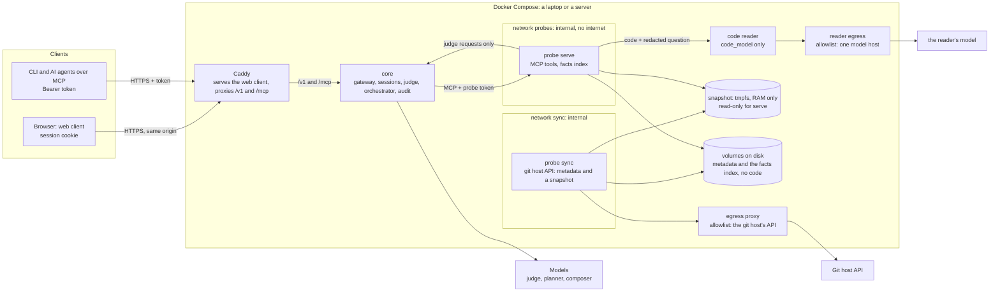

# How Mercury works

Mercury answers questions about a software project for people who don't read code: what is done,
what is tested, what is blocked and on what, how healthy the project is, what changed, and any other
question about the project that isn't off limits, such as how long a change might take: an
estimate, never a promise. This page describes its parts, how a question travels through them, and
where the trust boundaries are.

One rule shapes everything: **people talk to the core, the core talks to probes, probes talk to the
repository.** Nobody else talks to anybody.

## The parts

| Part | Runs as | Does | Holds |
|---|---|---|---|
| **Clients**: the web client, the `mercury` CLI, AI agents over MCP | a browser on a laptop or a desktop; a terminal | ask (the CLI prints the timeline; the web client shows a project manager one row per stage, a tech lead or an admin the full trail), approvals, the audit for an admin | web client: a session cookie the page can't read; CLI and agents: the person's own token |
| **Caddy** (the `mercury-web` image) | a container | TLS on a server, plain http on a laptop; serves the web client's static files; proxies `/v1/*` and `/mcp` to the core | TLS state |
| **Core** (`mercury-core`) | a container | identity and sessions, roles and policy, the judge, the orchestrator, a judge proxy for probes, the audit | the model provider's key, the probes' tokens |
| **Probe** (`mercury-probe`), one per repository | two containers (or another host) | `sync` fetches through the git host's API and keeps a snapshot of the default branch in RAM; `serve` indexes it and answers MCP tools with facts | `sync`: the git host token. `serve`: only its own probe token |
| **Code reader** (`mercury-probe reader`), only for a project in `code_model` | a container on the probes' network and an egress network of its own | takes the code and the redacted question from `serve` in one request, asks its one model, and hands back the reply, which `serve` checks into at most 12 short findings | the model's key, in a file, when its host needs one |

Everything runs in one Docker Compose project, on a laptop or on one Linux server
([deploy.md](deploy.md)).

## A question, end to end

Every step below is a row in the audit, written before anything is sent to the person, and the
CLI prints each one as a line of the question's timeline; the web client keeps them under *How
Mercury checked this*.

1. **Accepted.** `POST /v1/questions` with the text and an `Idempotency-Key`; the question is
   redacted with the global rules before anything else reads it.
2. **Project.** The one the person named, or the only one they may ask about, or a name or alias in
   the question; otherwise a judge picks among theirs, and when it isn't sure Mercury asks which
   (`clarify`).
3. **Class and input checks.** One judge request decides what kind of question it is (`progress`,
   `tested`, `blocked`, `health`, `changes`, or `open`: anything else about the project; a question
   not about it is out of scope) and runs the input checks: does it ask for code, ask to evaluate
   people, ask for a commitment to a client, ask for confidential information (contracts, prices,
   salaries, personal data, a client's internal information, security configuration), or carry
   instructions aimed at an AI? A check that doesn't pass refuses with its own code and a hint about
   what can be asked instead.
4. **Authorize.** The person's role and the project's manifest decide whether this class may be
   asked here, and whether its answer waits for an approver.
5. **Plan.** A fixed table maps the class to the probe's tools. A planner model fills only their
   arguments (a date, a module, a limit), each checked against what the probe declares; a value that
   fails is left at its default. No model ever chooses a tool. An `open` question gets every fact
   tool the probe serves, and the code reader's tool when the project has one; no planner is asked,
   and that tool's argument is the redacted question.
6. **Tool checks.** Rules (scope, denied classes) and a judge check that the arguments match the
   question and carry no instructions.
7. **Probe calls.** In parallel, five seconds each, 45 for the code reader; the replies must match
   their schema exactly. A call that fails leaves its part out, and the answer says so.
8. **Data checks.** Every text in the replies (only short titles and the reader's findings can be
   text) is redacted with the project's rules and checked; a flagged one is replaced before any model
   reads it.
9. **Compose.** A composer model writes from the facts and findings alone, as numbered units it must
   cite, says what it can't know, and words an estimate as an estimate, never a promise; without a
   model, a template writes the answer.
10. **Output checks.** Each sentence must cite a fact it was given, and each is checked by rules and
    by the judge (code, paths, secrets, client names, people, commitments, grounding). A sentence
    that fails is removed; one the judge isn't sure about waits for an approver when the project has
    one, and is removed otherwise.
11. **Deliver, or wait.** The `answer` event carries the checked text and the facts it rests on, with
    the lowest confidence among them; `done` says what the question cost and which judge decided. An
    answer held for sign-off waits for an approver, who approves it unchanged or rejects it with a
    note the person reads.

A judge that can't be reached hands its stage to a chat model, and then to rules, with stricter
thresholds each time: a judge error is never a pass. The timeline shows which one decided.

## Trust boundaries

1. **The internet to Caddy.** `/v1/*` and `/mcp` go to the core; every other path is the web
   client's static files. Every API call but `/v1/health` and the sign-in needs a token or the web
   client's session cookie; `/mcp` takes only the token. The browser talks only to its own origin,
   so the core sends no CORS headers, and a cookie request that changes state must carry the right
   `Origin` and `X-Mercury-Client`.
2. **The core to a probe.** MCP over an internal network, one token per probe, a fixed list of tools,
   replies validated against their schema and size caps; a probe that breaks the contract is
   quarantined.
3. **A probe's `serve` to anywhere.** Nothing. Its only way out is the core's internal listener (for
   registration and judge requests), which accepts only the probes' network and their tokens, and,
   in `code_model`, the code reader on the same network.
4. **A probe's `sync` to the git host.** The API only, through an egress proxy with an allowlist.
   Nothing can query `sync`. The snapshot of the code lives only in RAM; the disk holds metadata and
   facts, never code.
5. **The core to the models.** Redacted questions and facts, never code, with no-training,
   zero-retention routing where the model supports it, or a model server of your own.
6. **The code reader to its model.** The code and the redacted question, in one request, to the one
   host its egress allowlist holds: your own model server in `private` and `strict`; only the `demo`
   preset may name a host outside your network, with zero-retention routing. `serve` itself still
   has no route out.

## The code

| Unit | Kind | Notes |
|---|---|---|
| `mercury-schema` | Rust library | every type that crosses a boundary; the OpenAPI schemas come from it |
| `mercury-judge` | Rust library | the judge interface, the judge model's client, the chat and rules fallbacks |
| `mercury-core` | Rust binary | the server and its `admin` subcommands |
| `mercury-probe` | Rust binary | `sync`, `serve`, `reader` (the code reader), and `dev` for a local repository |
| `mercury` | Rust binary | the CLI |
| `apps/web` | Svelte 5 single-page app | static files served by Caddy; its types are generated from the core's OpenAPI document |

The contract a probe implements is in [probe-spec.md](probe-spec.md); the defences in
[security.md](security.md).
